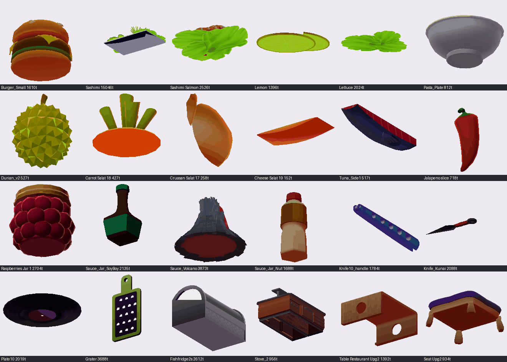
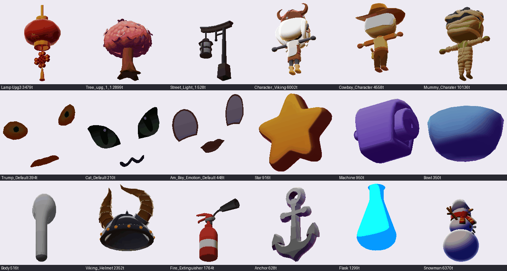
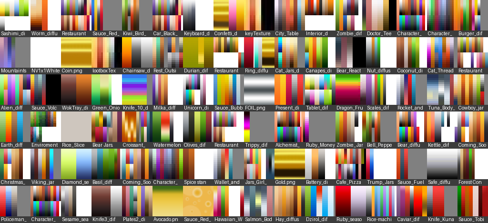
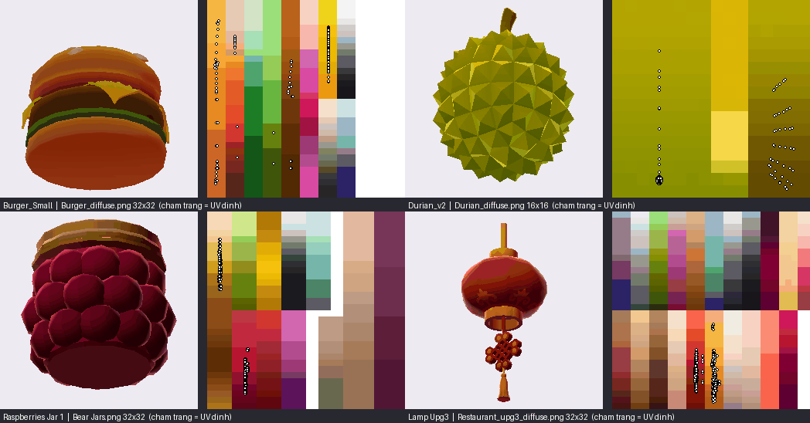
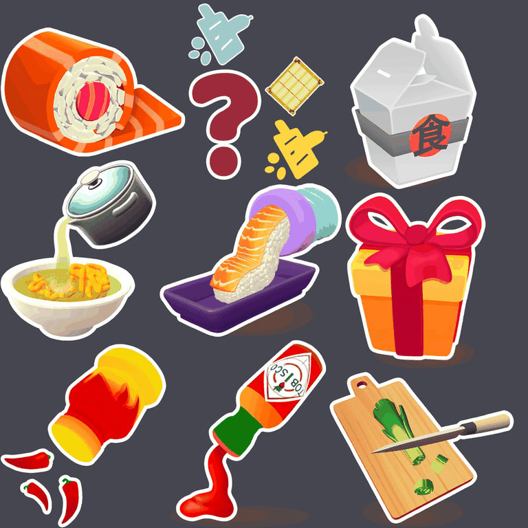
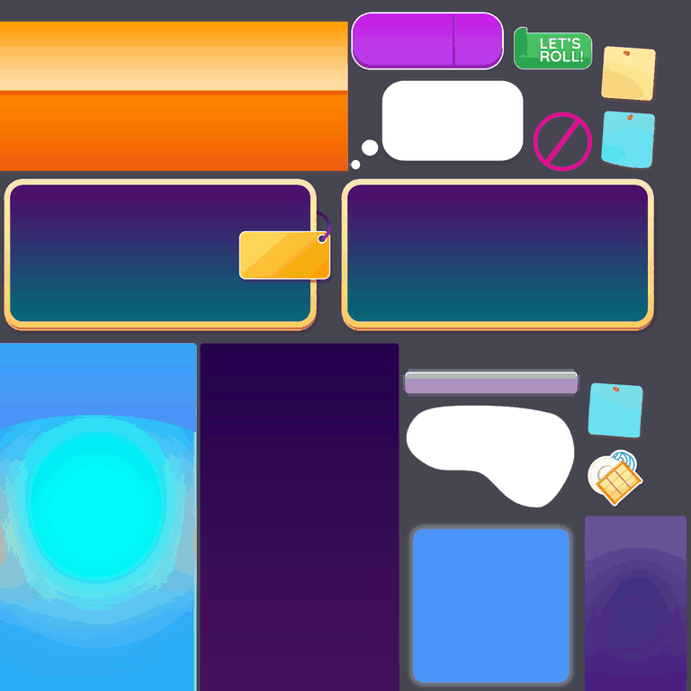
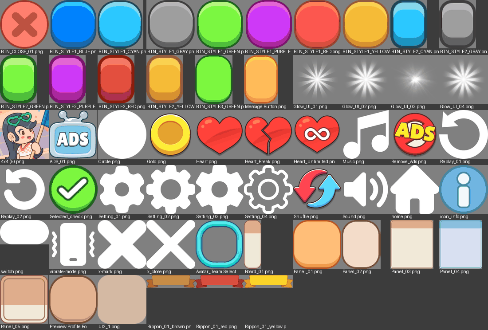

# Quy tắc dùng Gen AI để làm asset theo phong cách Sushi Roll 3D

Tài liệu này đúc kết từ việc phân tích **toàn bộ** model, texture, material của bộ [`SushiRoll3D`](../SushiRoll3D/README.md) và bộ UI của project **UltimateCooking**. Mục tiêu: có bộ quy tắc đo được để dùng Gen AI (ảnh 2D, image-to-3D) tạo asset mới cùng "chất" với game, nhưng là **thiết kế của riêng bạn**.

> Ngày phân tích: 2026-10-26. Các con số dưới đây được đo trực tiếp bằng script đọc file Unity YAML (giải mã vertex/index buffer, đọc material, thống kê pixel PNG), không ước lượng bằng mắt, trừ những chỗ ghi rõ.

---

## 0. Tóm tắt: 12 quy tắc cốt lõi

| # | Quy tắc | Căn cứ đo được |
|---|---|---|
| 1 | **AI chỉ lo hình khối. Màu do palette quyết định.** Bỏ texture PBR mà công cụ AI 3D sinh ra. | 940/957 mesh có texture dùng palette ≤ 32px |
| 2 | **Texture = palette gradient 32×32 (hoặc 16×16)**, 4–9 cột màu, mỗi cột là gradient dọc: **trên sáng, dưới tối và đậm hơn**. | 125 palette 32², 47 palette 16²; 84% sáng ở trên |
| 3 | **Không unwrap UV.** Dồn UV từng nhóm mặt vào **một điểm** hoặc **một dải dọc** bên trong một cột màu. | 95% tam giác: 38% UV dồn về điểm, 57% UV nằm trên dải dọc |
| 4 | **Không normal map, không vertex color, không lightmap UV, không bộ map PBR.** | 1/357 material TCP2 dùng bump; 0 mesh có vertex color; 8/1074 mesh có UV2 |
| 5 | **Shader toon mềm**: ramp threshold ≈ 0.4, ramp smooth ≈ 1.0, màu sáng xám trung tính (#C4C4C4), **màu bóng tím/đỏ đậm** (≈ #462C61). Rim light nhẹ, specular nhỏ. | 357 material Toony Colors Pro 2 |
| 6 | **Ngân sách poly**: đồ ăn/dụng cụ ~2k tris/vật; môi trường ~1.7k (cây to tới ~15k); nhân vật full body 4.5k–10k. | Mục 2.1 |
| 7 | **1 mesh – 1 material** là mặc định; tối đa 3 submesh (vỏ / ruột-mặt cắt / chi tiết). | 70% renderer dùng 1 material, 19% dùng 3 |
| 8 | **Tách mesh theo gameplay**: lát cắt dựng sẵn + material mặt cắt riêng; vảy cá rời; lọ = thủy tinh / nắp / nhãn / chất lỏng; mặt nhân vật là mesh rời theo cảm xúc. | Mục 2.3 |
| 9 | **Hình khối "đồ chơi"**: to, tròn, vát cạnh dày, tỉ lệ phóng đại, đọc rõ silhouette ở góc nhìn 3/4 từ trên xuống. Nhân vật chibi, đầu to. | Ảnh render mục 2.4 |
| 10 | **Màu bão hòa, thiên nóng**: đỏ + cam chiếm 54% mẫu màu có độ bão hòa; màu giữa swatch S ≈ 0.69, V ≈ 0.71. | Mục 3.1 |
| 11 | **Icon UI 2D** = ảnh render 3D toon, góc 3/4, **viền trắng kiểu sticker ≈ 2.5% kích thước icon**, bóng mềm dưới đáy, có "hành động" (rót, nhỏ giọt). | Mục 5.1 |
| 12 | **UI kit** (UltimateCooking): nút kẹo bo tròn đổi màu theo biến thể, 9-slice; icon glyph màu trắng đơn sắc, tô màu trong engine. | Mục 5.2 |

---

## 1. Phạm vi và giới hạn

**Nguồn đã phân tích**

| Nguồn | Nội dung | Dùng cho |
|---|---|---|
| `GameDevLearn/3D_Asset/SushiRoll3D/Assets` | 1074 mesh, 644 material, 382 PNG, 33 shader (dummy), 141 prefab FX/emoji, `mesh-material-map.json` (11036 cặp renderer–mesh–material) | Model, texture, material, icon |
| `UltimateCooking/Assets/JoyboyModule/UIExample/UI` | 56 sprite UI (nút, panel, icon, ribbon, glow) | UI kit |
| `UltimateCooking` (cấu hình) | Unity **6000.3.14f1**, **Built-in Render Pipeline** (không có package URP), uGUI, DOTween, Odin | Thiết lập import/shader |

Project UltimateCooking **chưa có model 3D hay material nào**, nên phần 3D hoàn toàn dựa trên SushiRoll3D. 135 PNG còn lại thuộc `Plugins` (icon editor của DOTween/Odin) nên bị loại.

**Giới hạn cần biết**

- 33 shader trong bộ SushiRoll3D là bản giả (AssetRipper DummyShader). Ảnh render trong tài liệu được dựng lại bằng renderer tự viết theo công thức toon ramp + rim của TCP2, dùng **thông số thật** trong material. Chúng gần đúng, **không phải màu gốc của game**.
- File `.meta` (thiết lập import texture) được AssetRipper tái tạo, có thể không giống project gốc. Phần thiết lập import ở mục 6 là **khuyến nghị**, không phải sao chép.
- Không phải mesh nào cũng được phục hồi. Thân nhiều nhân vật bị thiếu, chỉ còn mesh mặt.

---

## 2. Model 3D

### 2.1 Ngân sách tam giác

Tổng số tam giác **trên mỗi vật** (cộng mọi mesh trong cùng prefab nguồn):

| Nhóm | Số prefab | p25 | **Trung vị** | p75 | p90 |
|---|---:|---:|---:|---:|---:|
| Đồ ăn / nguyên liệu / gia vị / lọ sốt | 105 | 1111 | **1976** | 3234 | 5510 |
| Dụng cụ / máy bếp (dao, đĩa, máy Nigiri…) | 49 | 964 | **2019** | 2700 | 4504 |
| Môi trường / nội thất | 72 | 660 | **1721** | 3764 | 10890 |
| Đồ ăn cắt lát (cả bộ 10–24 lát) | 11 | 3435 | **4073** | 10987 | 13393 |
| Nhân vật full body (3 mẫu còn đủ mesh) | 3 | Cowboy 4558 · Viking 6002 · Mummy 10136 | | | |
| Mesh mặt biểu cảm (mắt/miệng) | — | 203 | **276** | 394 | 822 |

Từng mesh riêng lẻ: trung vị **298** tris, p90 2304, p99 11731, lớn nhất 33202 (cây, mặt nước gợn sóng).

### 2.2 Định dạng vertex và cách shading

| Thuộc tính | Kết quả | Quy tắc rút ra |
|---|---|---|
| Kênh vertex | 96% mesh chỉ có position + normal (+ tangent) + UV0 | Chỉ cần UV0 |
| Vertex color | **0 / 1074** mesh | Không dùng vertex color để tô màu |
| UV1 (lightmap) | 8 / 1074 mesh | Không bake lightmap. Ánh sáng do shader toon lo |
| Tangent | 64% mesh có tangent nhưng chỉ 1 material dùng normal map | Tắt tangent khi import để tiết kiệm 16 byte/vertex |
| Skinned / blendshape | 7 mesh skinned, 1 mesh có blendshape | Hầu hết đồ vật không rig. Hoạt cảnh làm bằng transform (DOTween) |
| Submesh | 1: 72% · 2: 10% · 3: 18% · tối đa 8 | ≤ 3 material mỗi vật |
| Normal (mẫu ngẫu nhiên 238 mesh) | 38% gần như smooth hoàn toàn, 13% gần như phẳng (faceted, vd. sầu riêng), còn lại smooth + cạnh cứng ở chỗ gấp | Auto Smooth ~30°, giữ cạnh cứng ở chỗ vát |
| Pivot | Không thống nhất: đáy-giữa 236, tâm 204, đỉnh/khác 93, lệch tâm theo phương ngang 463 | Tự chuẩn hóa: **đáy-giữa** cho đồ vật đặt trên bàn |

### 2.3 Cách chia mesh theo gameplay (quan trọng nhất cho game nấu ăn)

AI **không** tự làm được phần này. Phải làm tay trong Blender sau khi có model.

| Mẫu | Ví dụ trong bộ asset | Quy tắc |
|---|---|---|
| **Cắt lát dựng sẵn** | `Carrot Salat 0…18`: 19 lát, mỗi lát dày ~0.1 đơn vị, 69–427 tris, 2–3 submesh: vỏ `Carrot.mat` + mặt cắt `CarrotSlice.mat` | Cắt sẵn bằng Bisect (bật Fill). Mặt cắt gán material riêng (shader không rim/spec) |
| **Thao tác bề mặt** | `TunaFishCleaning`: 2 nửa thân (517 tris) + ~190 vảy rời (~96 tris/vảy) | Phần tử bị gỡ/cạo là mesh rời, low-poly, dùng chung material |
| **Đồ chứa chất lỏng** | `Sauce_Tobisco`: thủy tinh trong · nắp · nhãn · phần màu · chất lỏng (5 mesh) | Tách vỏ trong suốt / chất lỏng / nhãn để đổi shader và làm hiệu ứng rót |
| **Máy có bộ phận tương tác** | `NigiriPhase`: tay cầm, bánh xe, nút tròn/vuông/tim, đầu phun theo hình | Mỗi bộ phận chuyển động/bấm được là một mesh, pivot đặt ở trục quay |
| **Nhân vật đổi cảm xúc** | `Zombie_Default` 539 · `Zombie_Happy` 672 · `Zombie_Sad` 355 tris. Mắt, miệng là mesh phẳng | Sinh thân **mặt trơn**, mặt làm riêng thành bộ Default/Happy/Sad để bật/tắt |

### 2.4 Hình ảnh tham khảo

Render gần đúng (toon ramp + rim theo thông số material thật):




Đặc điểm hình khối quan sát được (đánh giá bằng mắt):

- Khối to, đơn giản, cạnh vát dày (ngôi sao, ghế, bàn), bề mặt hơi phồng.
- Chi tiết nhỏ được **làm bằng hình khối** (hạt mâm xôi, gai sầu riêng), không vẽ vào texture.
- Nhân vật chibi: đầu chiếm khoảng 40–50% chiều cao, tay chân ống đơn giản, dựng ở T-pose.
- Đồ ăn hơi phóng đại cho dễ đọc ở màn hình điện thoại (miếng cá, lát chanh dày).

---

## 3. Texture

### 3.1 Palette gradient: kỹ thuật cốt lõi



| Thông số | Giá trị đo |
|---|---|
| Số palette | 172 texture ≤ 32px (125 × 32², 47 × 16²) |
| Mesh dùng palette | **940 / 957** mesh có texture |
| Số cột màu mỗi palette | trung vị **7** (p25–p75: 4–9), mỗi cột rộng 2–4 px. Một số palette chia 2 hàng |
| Hướng gradient | 84% sáng ở trên, 12% sáng ở dưới, 4% phẳng |
| Chênh độ sáng trên–dưới (V) | trung vị **0.32** (p75 0.49) |
| Chênh độ bão hòa (S) | đáy đậm hơn đỉnh, trung vị **+0.13** |
| Lệch hue trên–dưới | gần 0 (trung vị −1°), dao động ±10–20° |
| Màu giữa swatch | S trung vị 0.69, V trung vị 0.71 |
| Phân bố hue (835 mẫu có màu) | đỏ 29% · cam 25% · hồng 8.5% · vàng 7.5% · lam nhạt 6.7% · lục 5.6% · xanh trời 4.2% · xanh dương 3.5% · tím 3.4% · khác 6.5% |
| Tái sử dụng | 148 palette được prefab dùng. Trung vị 2 prefab/palette, đặt tên theo vật (`Burger_diffuse.png`). `Colormap1.png` là palette chung, 22 prefab dùng |

**Cách UV bám vào palette** (chấm trắng là UV từng đỉnh):



- Tam giác có UV **dồn về 1 điểm** (38%) cho màu phẳng, ví dụ nhãn, nút, chi tiết nhỏ.
- Tam giác có UV **trên 1 dải dọc** trong một cột (57%): độ cao của mặt trên vật ứng với vị trí trên gradient. Kết quả là vật **tự có chuyển sắc trên sáng, dưới tối** mà không cần vẽ.
- Chỉ 5% tam giác được unwrap thật.

### 3.2 Texture vẽ tay (ít, chỉ cho "bề mặt đặc trưng")

Khoảng 20 texture 256–512px (đếm bằng mắt) dùng cho bề mặt cần họa tiết; chỉ 17 mesh có texture dùng loại này: thớ cá hồi cắt (`Salmon_cut`), tổ ong (`Honey_side`), dưa chuột, gỗ, vân gạo, kem/tuyết, mặt emoji. Đặc điểm: **phẳng, không đổ bóng, ít chi tiết, màu bão hòa**. Bóng do shader lo.

### 3.3 Texture FX

Sprite hạt (sparkle, glow, splash, mây, nốt nhạc, confetti) là **ảnh trắng/xám trên nền trong suốt**, nhiều frame dạng sheet 3×3 hoặc 6×3. Màu được tô bằng Particle System.

---

## 4. Material và shader

| Shader | Số material | Dùng cho |
|---|---:|---|
| Toony Colors Pro 2 (TCP2) Mobile, các biến thể | **357** | Gần như mọi vật thể 3D |
| `RollSurafces`, `RubbingFoodSurface` (custom, dựa trên tham số TCP2 + clip plane) | 60 + 60 | Bề mặt cuộn / chà xát trong gameplay |
| `GradientObject` | 13 | Nội thất bếp |
| `SpecialFX_Liquid2` | 11 | Chất lỏng có fill amount, bọt |
| Shader built-in (chủ yếu particle) | ~100 | FX, UI |
| TextMeshPro | 24 | Chữ |

Tất cả 357 material TCP2 dùng **chung 1 ramp texture** (`TCP2_Ramp_Unity.png`). 307/357 dùng palette 16–32px làm `_MainTex`. Chỉ 1/644 material dùng shader outline: viền đen/trắng gần như chỉ có ở icon 2D.

### 4.1 Preset TCP2 (trung vị theo biến thể)

| Biến thể | Số mat | Ramp Threshold | Ramp Smooth | Shininess | Rim Min → Max | Dùng cho |
|---|---:|---:|---:|---:|---|---|
| **Specular Rim** | 170 | 0.45 | 1.0 | 0.23 | 0.44 → 0.88 | Đồ ăn bóng, kẹo, đĩa sứ, lọ sốt |
| **Rim** | 88 | 0.30 | 1.0 | — | 0.46 → 0.92 | Nhân vật, dao, kem, hành lá |
| **Mobile** (cơ bản) | 59 | 0.48 | 0.9 | — | — | **Mặt cắt lát**, tường, sàn, cây cỏ |
| **Specular** | 35 | 0.21 | 0.98 | 0.22 | — | Bàn, lọ, đồng xu, đèn |

### 4.2 Màu ánh sáng và bóng

| Tham số | Giá trị đo | Gợi ý hex |
|---|---|---|
| `_HColor` (vùng sáng) | trung tính ở 318/357 mat (89%), V trung vị 0.75 | `#C4C4C4` |
| `_SColor` (vùng bóng) | **có màu** ở 295/357 (83%): tím 75 · đỏ 68 · cam 40 · hồng 36 · tím hồng 30; xám 62. S ≈ 0.69, V ≈ 0.38 | tím `#462C61`, nóng `#592D24` |
| `_RimColor` | xám tối, alpha 0.6 | `#4C4C4C` a=0.6 |
| `_SpecColor` | xám rất tối (highlight nhỏ, tinh tế), `_SpecSmooth` = 0.05 (highlight cạnh sắc) | `#1F1F1F` |

**Quy tắc màu bóng:** bóng không bao giờ là xám thuần. Chọn tông **tím** cho vật lạnh/trung tính, tông **đỏ–nâu** cho đồ ăn nóng (thịt, bánh, sốt).

> UltimateCooking hiện **chưa có TCP2** và đang chạy Built-in RP. Hai lựa chọn: (1) mua TCP2 (có hỗ trợ Built-in) và dùng nguyên preset trên; (2) tự viết shader toon nhỏ với cùng tham số: `ramp = smoothstep(thr - smooth/2, thr + smooth/2, N·L)`, `màu = albedo × lerp(SColor, HColor, ramp) × màuĐèn`, cộng rim `smoothstep(RimMin, RimMax, 1 - N·V) × RimColor.a`.

---

## 5. UI 2D

### 5.1 Icon vật phẩm (Sushi Roll 3D)

Nhận xét trong mục 5 là đánh giá bằng mắt, trừ kích thước file và độ dày viền (đo bằng script).



- Là **ảnh render từ model 3D toon** (hoặc vẽ giả 3D), góc nhìn 3/4, hơi nghiêng cho có động.
- **Viền trắng kiểu sticker**: đo trên 11 icon, viền bằng 2.1–3.5% cạnh dài của icon, trung vị **≈ 2.5%** (14–18px ở icon ~700px). Các mảnh nhỏ đi kèm giữ viền ~15px cố định nên tỉ lệ cao hơn.
- Bóng mềm, tối, hình elip dưới đáy.
- Có **hành động**: nồi đang rót, lọ sốt đang chảy, dao đang cắt.
- Gói trong atlas 2048² (Crunch). Panel: gradient tím → xanh lục lam, viền kem/vàng bo tròn, banner cam gradient.



### 5.2 UI kit của UltimateCooking (JoyboyModule)



| Thành phần | Đặc điểm | Quy tắc khi sinh bằng AI |
|---|---|---|
| Nút `BTN_STYLE1/2/3_<MÀU>` | Cùng 1 hình, 7 màu (blue, cyan, gray, green, purple, red, yellow). 3 tông: nền, dải sáng trên, viền/đáy tối. 159×159 và 74×98 | Sinh **1 nút gốc**, đổi màu bằng chỉnh hue/HSV, **không** sinh lại từng màu |
| Icon glyph (`Setting`, `Sound`, `home`, `x_close`…) | Trắng đơn sắc (2 màu: trắng + alpha), 256×256 | Sinh dạng silhouette trắng hoặc SVG, tô màu bằng `Image.color` |
| Icon có màu (`Heart`, `Gold`, `Remove_Ads`) | 512×512, viền tối dày, highlight trắng | Cùng độ dày viền, cùng hướng sáng (trên-trái) |
| Panel / board | Kem/đào, viền nâu, 9-slice 30–70px | Đặt `spriteBorder` ngay khi import |
| Ribbon | 397×107, 3 màu (brown, red, yellow) | Như nút: 1 mẫu, đổi màu |
| Glow | Trắng tỏa tia, 512×512 | Ảnh trắng trên nền trong suốt |

---

## 6. Quy trình Gen AI đề xuất

```
Concept 2D (AI ảnh) ──► Image-to-3D (AI) ──► Blender: dọn mesh, tách mảnh, pivot
        │                                            │
        └── trích màu ──► tools/make_palette.py ──► gán UV vào palette
                                                     │
                       Unity: import + material toon preset + QA checklist
```

### Bước 1: Ảnh concept (Midjourney, ChatGPT/GPT Image, Gemini, FLUX…)

**Mẫu prompt** (giữ tiếng Anh vì model ảnh hiểu tốt hơn):

```
stylized 3D game asset of [OBJECT], mobile casual cooking game style,
chunky simplified toy-like shapes, thick soft bevels, exaggerated proportions,
toon shading with soft gradient, saturated warm colors, purple-tinted shadows,
subtle rim light, clean solid colors with no texture detail,
single object centered, 3/4 top-down view, plain light grey background
```

**Negative / tránh:** `photorealistic, PBR, high-frequency texture, noise, grain, scratches, dirt, text, logo, watermark, multiple objects, dramatic lighting, cast shadow on background`.

Khi dùng làm input cho image-to-3D, sinh thêm bản **chính diện / bên cạnh, ánh sáng phẳng**. Nhân vật: **T-pose, mặt trơn** (mặt làm riêng).

### Bước 2: Image-to-3D (Meshy, Tripo, Rodin, Hunyuan3D, TRELLIS…)

- Đặt số mặt mục tiêu (nếu công cụ có) gần ngân sách ở mục 2.1, hoặc sinh bản dày rồi giảm ở bước 3.
- **Loại bỏ** kết quả có: mảnh rời lơ lửng, lỗ thủng, mặt méo không đối xứng (với vật cần đối xứng), ánh sáng bị bake vào texture.
- Chỉ giữ **hình khối**. Texture AI sinh ra chỉ dùng để tham khảo màu.

### Bước 3: Dọn mesh trong Blender

1. Merge by Distance, Recalculate Normals, xóa mảnh rời.
2. Giảm poly (Decimate / Quad Remesh) về đúng ngân sách. Kiểm tra silhouette ở góc nhìn camera game.
3. Shade Auto Smooth ~30°, thêm hoặc giữ cạnh vát dày cho cảm giác "đồ chơi".
4. **Xóa UV và material AI.**
5. Tách mảnh theo gameplay (mục 2.3): lát cắt + material mặt cắt, phần lỏng, nắp, nhãn, mặt nhân vật.
6. Pivot đáy-giữa (bộ phận quay: pivot ở trục). Apply Transform. Xuất FBX: Forward −Z, Up Y, Apply Scalings = FBX All.

### Bước 4: Palette và UV

1. Tạo palette từ ảnh concept hoặc mã màu:
   ```bash
   python tools/make_palette.py Burger_palette.png --from-image burger_concept.png --count 8
   python tools/make_palette.py Burger_palette.png --colors "#E8742C,#F2C14E,#3E8E3A,#7A3B1E,#F4E6C8"
   ```
   Script ghi `Burger_palette.png` (32×32, gradient theo số đo ở mục 3.1) và `Burger_palette.json` chứa vùng UV (`u_min/u_max/v_min/v_max`) của từng swatch.
2. Trong UV Editor của Blender, với mỗi vùng màu:
   - **Màu phẳng:** chọn mặt → `S` `0` (dồn về một điểm) → kéo vào giữa cột swatch.
   - **Có chuyển sắc:** Project From View (nhìn chính diện) → `S` `X` `0` (ép bề ngang về 0) → co giãn theo chiều dọc cho nằm trong `[v_min, v_max]`. Phần cao của vật nằm ở phần sáng của cột.
3. **Không để UV vượt ra ngoài cột swatch** (dùng `u_min/u_max` trong JSON) để filter không ăn màu cột bên cạnh.
4. Mỗi vật hoặc mỗi họ vật dùng 1 palette riêng, đặt tên `<TênVật>_diffuse.png`. Đồ vật vặt có thể dùng chung 1 palette tổng kiểu `Colormap1`.

### Bước 5: Import vào Unity

| Loại | Thiết lập khuyến nghị |
|---|---|
| Model (prop) | Normals: Import · **Tangents: None** · Generate Lightmap UVs: tắt · Blend Shapes: tắt · Animation: None · Read/Write: chỉ bật nếu cắt mesh lúc chạy |
| Palette 32×32 | Max Size 32 · **Compression: None** (chỉ 3 KB, tránh nén làm lem màu giữa các cột) · **Mipmap: tắt** · Wrap: Clamp · Filter: Bilinear (có gradient) hoặc Point (màu phẳng) |
| Texture vẽ tay | 256–512px · có mipmap · nén ASTC/ETC2 |
| Icon UI | Sprite (2D and UI) · cho vào Sprite Atlas · đặt 9-slice cho panel/nút |
| Material | Dùng preset ở mục 4.1 theo loại vật. Mặt cắt dùng biến thể cơ bản, không rim/spec |

### Bước 6: Sinh icon UI cho vật phẩm

Cách **ổn định nhất**: chụp chính model 3D vừa làm trong Unity (góc 3/4, shader toon) rồi thêm viền trắng ~2.5% và bóng đáy bằng script hoặc Photoshop action. Toàn bộ icon sẽ nhất quán với model trong game.

Nếu dùng AI ảnh:

```
game item icon of [OBJECT], stylized 3D render, toon shading, 3/4 view, slight tilt,
thick white sticker outline, soft dark oval shadow below, saturated colors,
[ACTION e.g. pouring sauce / dripping], transparent background, centered
```

Sau đó chuẩn hóa: cùng kích thước canvas, cùng độ dày viền, cùng hướng sáng.

---

## 7. Checklist QA cho asset AI (pass hết mới đưa vào game)

- [ ] Tris nằm trong ngân sách nhóm (mục 2.1). Silhouette vẫn đọc rõ ở kích thước hiển thị trên điện thoại.
- [ ] Không còn texture/UV/material do AI sinh. Mesh chỉ có UV0.
- [ ] UV nằm trọn trong cột swatch. Không có tam giác UV vắt qua 2 cột.
- [ ] Palette 16² hoặc 32², đỉnh sáng hơn đáy, màu giữa S ~0.5–0.85, V ~0.55–0.85.
- [ ] Tối đa 3 material/vật. Mặt cắt dùng material riêng.
- [ ] Mảnh gameplay đã tách (lát cắt, chất lỏng, nắp, mặt nhân vật). Pivot đúng vị trí.
- [ ] Material dùng preset toon; `_SColor` có màu (tím/đỏ), không xám thuần.
- [ ] Không có normal map, vertex color, lightmap UV. Tangents tắt khi import.
- [ ] Icon: viền trắng ~2.5%, bóng đáy, góc 3/4, cùng canvas với bộ icon hiện có.
- [ ] Không chứa logo, chữ, nhân vật hoặc thương hiệu của bên thứ ba.

---

## 8. Lưu ý pháp lý

Bộ SushiRoll3D là art của bên thứ ba (xem [README của gói](../SushiRoll3D/README.md)). Tài liệu này chỉ rút ra **quy tắc phong cách đo được** (kích thước palette, thông số shader, ngân sách poly), là những thứ không gắn với thiết kế cụ thể. Để an toàn khi phát hành:

- **Không** đưa ảnh, model hay texture của Sushi Roll 3D vào AI làm input (img2img, image-to-3D) hay dữ liệu train (LoRA). Không bảo AI "làm giống Sushi Roll 3D".
- Không tái tạo thiết kế cụ thể, nhân vật hoặc nhại thương hiệu có trong bộ asset (vd. chai "Tobisco", nhân vật Among Us, người nổi tiếng).
- Prompt chỉ mô tả **thuộc tính phong cách** (toon, palette gradient, viền sticker…) như ở mục 6.

---

## Phụ lục: cấu trúc thư mục

```
GenAI_Style_Guide/
├── README.md              ← tài liệu này
├── images/                ← ảnh tham khảo (render gần đúng, palette, UI)
└── tools/
    └── make_palette.py    ← tạo palette gradient 32×32 + JSON vùng UV (cần Pillow)
```
